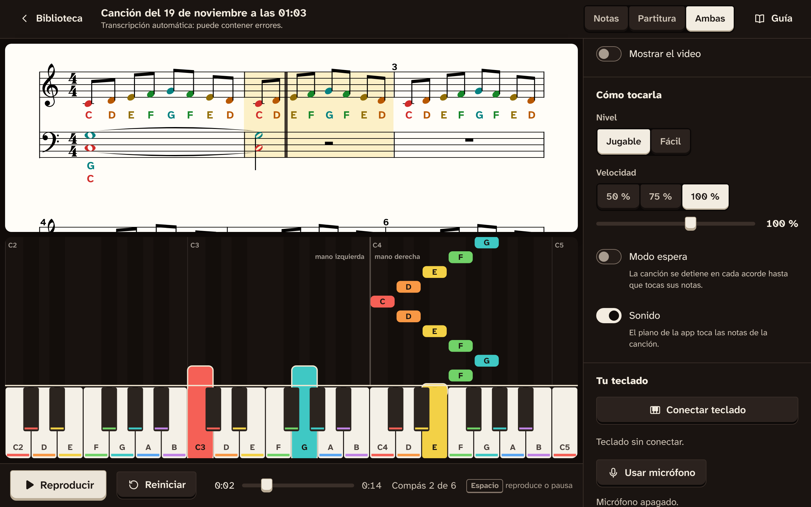
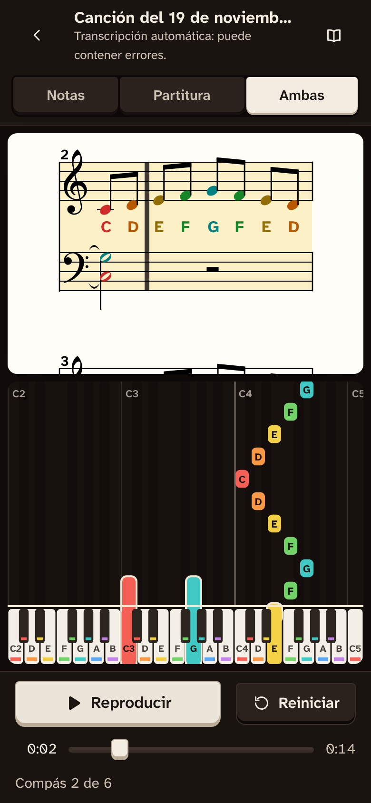

# Notacaida

**Live: <https://notacaida.duckdns.org>**

Free web app to practice piano with a digital keyboard over USB: paste the YouTube
link of a piano cover, and the app transcribes it and lets you practice with falling
notes, synchronized sheet music, wait mode and automatic rewind when you miss a note.

> **Status: Phase 1 (MVP) in progress.** Deployed and working end to end on the
> author's VPS; being polished before a public launch. See [`docs/status.md`](docs/status.md).



## What it does

1. Paste the link of a piano cover. The server downloads the audio, transcribes it
   (ByteDance piano model), simplifies it to at most 10 simultaneous notes while keeping
   the harmony, finds the beat and builds the sheet music.
2. You are told when it is ready (browser notification). The song is delivered to your
   browser and **deleted from the server**; it lives in your browser's library.
3. Practice with falling notes, the score with a cursor, or both at once, plus the
   YouTube video, adjustable speed and two levels (playable, easy). With a USB/Bluetooth
   MIDI keyboard (Chrome or Edge), or with the microphone, you can use **wait mode**: the
   song stops until you play the right chord, and rewinds if you miss. Progress per level
   is kept, with a "mastered" mark.
4. Learn to read while you play: every note has one colour on the key, the falling bar and
   the notehead, the score can write each note's name (C D E or Do Re Mi), and a reading
   guide explains clefs, note values, rests, accidentals, time signatures and chords with
   drawn examples. The visual identity is described in
   [`docs/phase-1/identidad-visual.md`](docs/phase-1/identidad-visual.md) (Spanish).



The screenshots show a synthetic exercise, not a real song.

## Why a Phase 0

The riskiest assumptions are technical: can the server fetch audio from YouTube, and
is the transcription good and fast enough on a small ARM64 VPS (Oracle Always Free,
2 OCPU / 12 GB)? Phase 0 is a CLI that answers both with ten real covers.

**Gate 1:** at least 8 of 10 songs recognizable by ear, and under 2 minutes of
processing per 3-minute song (real-time factor ≤ 0.67).

## Architecture (backend)

Ports and adapters, dependencies pointing inward:

```
cli ─▶ application (use cases, ports) ─▶ domain (pure rules)
              ▲
        infrastructure (yt-dlp, Basic Pitch, ByteDance model, synthesizer, meters)
```

Downloader, transcribers, synthesizer and the resource meter sit behind interfaces,
so each can be swapped without touching the domain. Decisions are recorded as ADRs in
[`docs/adr/`](docs/adr/) (D-01 … D-12).

## Run it

Backend and frontend for development (Python 3.11+, [uv](https://docs.astral.sh/uv/),
Node 22, ffmpeg and Deno):

```bash
cd backend && uv sync --python 3.11 --extra synth --extra basic-pitch --extra bytedance --extra score
uv run pytest -q                      # offline tests
cd ../frontend && npm ci && npm run typecheck && npm run lint && npm test
npm run e2e                           # browser tests with a mocked API
npm run e2e:full                      # the main flow with the real backend, offline
```

Deploying on a VPS (Docker, Nginx, HTTPS): [`docs/phase-1/despliegue-vps.md`](docs/phase-1/despliegue-vps.md).
The plan and decisions are in [`docs/phase-1/plan.md`](docs/phase-1/plan.md) and [`docs/adr/`](docs/adr/).

## Phase 0 benchmark

Run the benchmark with Docker (linux/arm64 image; also builds on amd64):

```bash
export HOST_UID=$(id -u) HOST_GID=$(id -g)
mkdir -p phase0-output phase0-models
docker compose -f infra/docker-compose.yml build
docker compose -f infra/docker-compose.yml run --rm phase0 phase0 run --links /data/links.txt --out /data/out
docker compose -f infra/docker-compose.yml run --rm phase0 phase0 gate --out /data/out
```

Without Docker (needs Python 3.11+, [uv](https://docs.astral.sh/uv/), ffmpeg and Deno):

```bash
cd backend
uv sync --python 3.11 --extra synth --extra basic-pitch --extra bytedance
uv run pytest -q -m "not network"          # offline tests (+ integration with Basic Pitch)
uv run notacaida phase0 run --links ../links.txt --out ../phase0-output
uv run notacaida phase0 gate --out ../phase0-output
```

Step-by-step guide for the VPS with ten covers: [`docs/phase-0/runbook.md`](docs/phase-0/runbook.md).

## Configuration

Environment variables (see `.env.example`): `NOTACAIDA_PROXY_URL` (optional proxy for
yt-dlp) and `NOTACAIDA_MAX_DURATION_SECONDS`. Secrets never go in the repository.

## Legal notes

The tool downloads audio only to transcribe it and deletes it right after. This
repository contains no audio or MIDI of copyrighted songs, and Phase 0 outputs are
git-ignored. Only paste links to audio you have the right to use. YouTube's terms of
service restrict downloading; see `docs/adr/0004-origen-del-audio.md` for the accepted
risk and mitigations.

## License

MIT. Third-party notices in [`NOTICE`](NOTICE).
