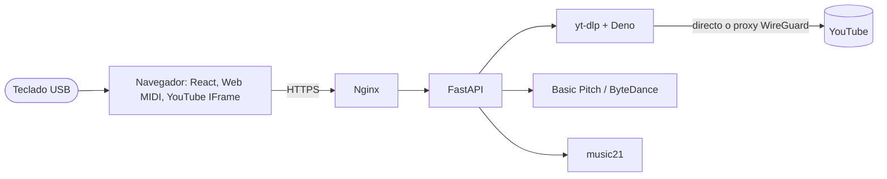

# Arquitectura de Teclario (nombre provisional)

## Contexto
Aplicación web gratuita para practicar piano con un teclado USB a partir del enlace de YouTube de un cover. Hoy se construye solo la **Fase 0**: un comando de backend que decide la compuerta 1 (¿baja el audio la VPS y transcriben bien y rápido los modelos?).

## Contenedores (objetivo del MVP)

El audio se baja, se transcribe y se borra en la VPS; nunca llega al navegador.

## Estilo y regla de dependencias (backend)
Hexagonal: `cli` → `application` → `domain`; `infrastructure` implementa los puertos que define `application`. El dominio no importa frameworks.

| Capa | Contenido en la Fase 0 |
| --- | --- |
| `domain` | `VideoUrl` (valida enlaces de YouTube), errores, `TranscriptionRun`, `ResourceUsage`, regla de la compuerta |
| `application` | Puertos `AudioDownloader`, `Transcriber`, `Synthesizer`, `ResourceMeter`; caso de uso `RunBenchmark`; generador de informe |
| `infrastructure` | Adaptadores de yt-dlp (proxy opcional), Basic Pitch, ByteDance, sintetizador y medidor de recursos |
| `cli` | `teclario phase0 run` y `teclario phase0 gate` |

## Flujo de la Fase 0
1. Lee los enlaces (archivo local ignorado por git) y valida cada uno con `VideoUrl`.
2. Baja solo el audio (yt-dlp), con proxy si `TECLARIO_PROXY_URL` está definido.
3. Para cada modelo: transcribe en un subproceso (pico de memoria limpio), guarda el MIDI y un WAV sintetizado.
4. Borra el audio descargado, siempre (también ante errores).
5. Genera `report.md` con tiempo, factor de tiempo real y memoria por modelo, y una plantilla `verdicts.csv` para anotar de oído si la canción es reconocible. `teclario phase0 gate` lee ese archivo y aplica el criterio.

## Atributos de calidad
Privacidad (sin URLs en logs, sin medios en git), testabilidad (puertos con dobles), portabilidad (linux/arm64, modelos intercambiables), mantenibilidad (Ruff, mypy estricto).

## Riesgos
- YouTube bloquea la IP de la VPS → proxy por WireGuard (ADR 0004).
- TensorFlow en ARM64 → Basic Pitch con ONNX por defecto (ADR 0006).
- Licencia del checkpoint de ByteDance sin verificar → `docs/phase-0/model-licenses.md`.
